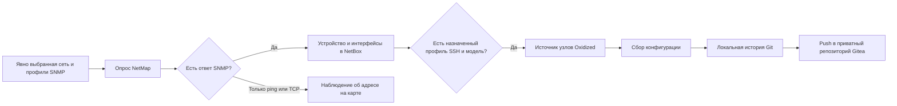

# NetMap: автоматическое наполнение NetBox без Diode

Дата описания: 6 ноября 2026 года.

Документ описывает существующую реализацию переносимой PL и условия, при которых
её можно использовать вместо отдельного процесса загрузки данных через Diode.
Это описание устройства продукта и основа для будущей модернизации действующего
контура. Применение этой схемы в production требует проверки его источников и
правил записи: текущий production в рамках этой работы не изменяется.

Настройки нескольких упорядоченных SNMP-профилей ниже описывают текущие
исходники. Живая проверка выполнена на ранее установленном NetMap 1.0.0 с одним
профилем; её точная версия artifact и результаты приведены в разделе 7.

## 1. Как проходит опрос

Первичное обнаружение выполняет NetMap через SNMP. Oxidized получает список
уже зарегистрированных устройств из NetBox и собирает их конфигурации.
Появление устройства в NetBox не зависит от успешного SSH-входа: это два
разных этапа с разными учётными данными и результатами.

Diode в этом пути не участвует. Adapter NetMap обращается к штатному NetBox REST
API. В модуле остаются семь компонентов: PostgreSQL, Valkey, NetBox,
NetBox worker, adapter, Oxidized и Gitea. Новый постоянный сервис для записи
обнаруженных объектов не нужен.

Установка модуля сама не запускает сканирование. Администратор добавляет сеть,
выбирает профили доступа и явно запускает опрос. Текущий опрос ограничен десятью
минутами; адреса обрабатываются восемью потоками. Следующий опрос нельзя запустить
параллельно уже выполняющемуся опросу этого adapter.

## 2. Какие сведения собираются

Текущий встроенный SNMP probe использует SNMP v2c. Он читает:

| Данные | Источник |
|---|---|
| Имя устройства | `sysName`, OID `1.3.6.1.2.1.1.5.0` |
| Описание устройства | `sysDescr`, OID `1.3.6.1.2.1.1.1.0` |
| Имя и описание интерфейса | `ifName`, `ifDescr` |
| Подпись интерфейса | `ifAlias` |
| Тип интерфейса | `ifType` |
| Административное и рабочее состояние | `ifAdminStatus`, `ifOperStatus` |

Опрос таблиц ограничен количеством строк и объёмом ответа. Счётчик ошибок
увеличивается при таймауте, ненулевом коде завершения клиента, превышении
допустимого объёма ответа или истечении общего deadline. Ограничение числа
строк само по себе не доказывает полноту таблицы: лишние строки обрезаются.
Сообщения SNMP об окончании таблицы не принимаются за дополнительные интерфейсы.

Community передаётся клиенту net-snmp через временный конфигурационный файл с
правами `0600`. Она не включается в аргументы `snmpget`/`snmpwalk` или отчёт
опроса. Временный файл удаляется после обращения к устройству.

Текущая реализация не собирает SNMP v3, таблицы IP-адресов с масками или
LLDP/CDP через этот probe. Наличие этих данных в другом процессе production
нельзя считать покрытым только потому, что Device появился в PL.

## 3. Разные пароли у устройств одной сети

Профили SNMP и SSH выбираются независимо.

Для сети можно задать до четырёх профилей SNMP в явном порядке. Для каждого
адреса NetMap пробует выбранные профили до первого успешного ответа. В отчёте
сохраняется, какие профили были проверены и какой сработал. Успех SNMP не
означает, что SSH-пароль из того же профиля подходит устройству.

У сети есть профиль SSH по умолчанию для первоначального подключения новых
устройств. Для отдельного устройства можно назначить другой профиль и модель
Oxidized. Уже существующие назначения не меняются при повторном SNMP-опросе
или при смене сетевого профиля по умолчанию.

Пример: два коммутатора одной сети отвечают на разные community, а маршрутизатор
использует другой SSH-пароль. В сеть добавляют нужные SNMP-профили; SSH-доступ
задают отдельно для сети и при необходимости переопределяют у устройства.

Прежняя конфигурация с одним объединённым профилем поддерживается: пока явный
список SNMP-профилей не сохранён, community берётся из прежнего профиля сети.
Явный пустой список означает отсутствие SNMP-опроса, а не выбор всех профилей.

## 4. Как объекты создаются и обновляются

### Устройство

Идентификатор сети вычисляется из её канонического CIDR. Для поиска ранее
созданного устройства используются два custom field:

- `pl_source = network:<идентификатор сети>`;
- `collector_ip = адрес, по которому выполнен опрос`.

Это идентичность в пределах источника. Имя, похожий MAC или одинаковый IP в
другой сети не являются основанием автоматически объединить объекты. При
нескольких совпадениях запись останавливается с ошибкой.

Для нового устройства adapter создаёт или находит площадку сети, базового
производителя и тип `Discovered`, роль `Network device`, затем создаёт Device.
Имя берётся из `sysName`; при отсутствии имени используется адрес. Конфликт
имени в той же площадке разрешается стабильным суффиксом.

Новый Device получает tag `pl-managed` и observation fields. Когда сетевой
профиль содержит SSH-пользователя, пароль и модель Oxidized, добавляются
`network-config-backup` и `collector_profile`.

При повторном опросе существующего Device обновляются только наблюдаемые
имя и описание — `pl_observed_name` и `pl_observed_description`. Adapter
повторно читает объект с ETag и выполняет условный PATCH с `If-Match`.
Изменение объекта между чтением и записью не должно быть затёрто.

Ручные имя, площадка, роль, комментарии, tags, собственные custom fields,
назначенный SSH-профиль и переопределение модели сохраняются.

### Интерфейс

Интерфейс сопоставляется в пределах Device по `pl_source` и `pl_if_index`.
Первый опрос создаёт Interface с наблюдаемыми именем, типом, подписью и
административным состоянием. Для следующих опросов используются observation
fields:

`pl_observed_if_name`, `pl_observed_if_alias`, `pl_observed_if_type`,
`pl_observed_admin_status`, `pl_observed_oper_status`.

Ручные `name`, `type`, `description`, `enabled` существующего Interface
сохраняются. Если новый обнаруженный интерфейс конфликтует по имени с уже
существующим ручным объектом, он не захватывается автоматически: увеличивается
`manual_conflicts`.

Этот путь не удаляет устройства или интерфейсы, переставшие отвечать. Нельзя
считать один неуспешный опрос доказательством, что объект нужно удалить.

### Что не становится объектом NetBox

Ответ только на ICMP или TCP сохраняется как адресное наблюдение для карты.
Импортированные DHCP/ARP/Wi-Fi reports также остаются наблюдениями. Они не
создают Device, Interface или IPAddress автоматически.

Адрес управления сейчас хранится в `collector_ip`. Это не создание объекта
IPAddress в IPAM и не назначение `primary_ip` устройству. Physical Cable также
не создаётся: ARP/FDB или соседство адресов не доказывают соединение физических
портов. Карта читает зарегистрированные Cable из NetBox.

## 5. Как устройство попадает в Oxidized

Adapter публикует аутентифицированный внутренний источник
`/internal/oxidized/nodes`. Он выбирает Device с tag `network-config-backup`,
адресом `collector_ip` и действующим `collector_profile`.

Модель берётся из `oxidized_model` у Device; если переопределение пустое — из
профиля. Нужны также имя пользователя и пароль SSH. Имя узла Oxidized имеет
вид `device-<NetBox ID>`, поэтому ручное переименование Device не создаёт новый
узел коллектора.

SSH host keys берутся из `ssh_known_hosts` выбранных профилей. Проверка ключей
сохраняется. Добавление устройства не означает автоматического доверия любому
ключу, предъявленному по его адресу.

После записи inventory adapter обновляет источник коллектора. Oxidized
сохраняет конфигурацию в локальный Git, а hook `post_store` отправляет историю
в приватный репозиторий Gitea `pl-collector/device-configs`.

Сбор running/startup определяется моделью Oxidized. Замена процесса inventory
сама не переносит специальные модели действующего контура и не подтверждает
эквивалентность собранных конфигураций. Running нельзя сохранять в startup
сетевого устройства ради получения снимка.

## 6. Как проверить результат в интерфейсе

1. Добавить профиль с действующей SNMP community. Если нужны конфигурации,
   подготовить SSH-доступ, модель Oxidized и доверенный host key.
2. Добавить небольшую известную сеть или отдельный `/32`, выбрать SNMP-профили
   и при необходимости SSH-профиль по умолчанию.
3. Запустить опрос и дождаться его конечного результата.
4. Проверить появление Device и Interface в NetBox, а не только адреса на карте.
5. При настроенном SSH проверить узел `device-<ID>` в Oxidized и конфигурацию
   с историей в Gitea.
6. Повторить опрос. ID Device/Interface должны остаться прежними; дубликаты
   появляться не должны.
7. Изменить подпись тестового интерфейса вручную и повторить опрос: ручная
   подпись должна сохраниться, наблюдаемая подпись обновляется отдельно.

Основные поля результата: `targets_total`, `responders`, `unresponsive`,
`devices`, `device_ids`, `interfaces_created`, `interfaces_updated`,
`manual_conflicts`, `errors`, `observed_hosts`, `warnings`, `snmp_attempts` и
состояние `collector`. Счётчик `devices` — число обработанных устройств,
а не число новых Device: при втором опросе он также может быть ненулевым.

При ошибке записи в NetBox опрос получает конечное состояние `error`.
Успешный ответ SNMP и появление точки на карте сами по себе не подтверждают
успешную запись inventory или сбор конфигурации.

## 7. Проверки реализации

Ключевой integration test —
[`test_netmap_enrollment.py`](../../installer/tests/test_netmap_enrollment.py).
Он выполняет настоящий `poll → enroll → sync_interfaces → nodes` и использует
настоящий SQLite Store. Подменены SNMP probe и граница HTTP NetBox; это source
integration test, не доказательство работы настоящих SNMP/NetBox/Oxidized.

В сценарии два устройства отвечают через разные SNMP-профили. Первый опрос
создаёт два Device и четыре Interface. Повторный опрос выполняет только PATCH,
сохраняет ID, ручные поля, tags и независимое назначение SSH. Смена сетевого
SSH default не перезаписывает существующее назначение устройства.

На 6 ноября targeted suite `test_netmap*.py` прошёл: 171 тест. Независимая
проверка документа и теста также выполнена.

### Живая проверка 6 ноября 2026 года

Проверялась существующая установка **PL 0.5.6 / NetMap 1.0.0** с одним
контролируемым имитатором сетевого устройства. SNMP и SSH действительно
передавались по сети; запись шла в настоящий NetBox, сбор — через настоящий
Oxidized, история — в Git/Gitea. Это не опрос физического маршрутизатора.

Точная identity проверенного adapter: source SHA256
`a63db47bd65388c472663fd70d4648afb71c6ce13510d5e05fd1e06bab06ff44`,
artifact SHA256
`e6a141e28e29191e336710a7bb961cd4b1fea090b847f6cc0d992d927c2c2787`.

| Проверка | Наблюдаемый результат |
|---|---|
| Первый обычный опрос через сессию PL и CSRF | Один ответивший `/32`, один Device, два Interface, ноль ошибок |
| Повторный опрос | Прежние ID; ноль новых Interface, два обновления, ноль ошибок |
| Ручные правки тестовых объектов | Device comments, Interface description/enabled сохранены |
| Источник Oxidized | Один target, состояние `ready` |
| SSH и чтение конфигурации | Две успешные аутентификации, два чтения, ноль отказов аутентификации |
| История | Локальный Git и Gitea подтвердили один commit `fb2bbb77cd0f04c47c3bb5f3b3f31a78991c33ac` |

На этой установке запрос нового маршрута просмотра устройств вернул HTTP 403.
Поэтому результат записи читался через native NetBox API из существующего
adapter. Эта проверка не подтверждает новый UI/API core 0.5.7
или несколько упорядоченных SNMP-профилей в новом artifact: для последних
подтверждён source integration test выше.

После проверки временный процесс-имитатор, профиль, сеть, Device, Interface
и площадка теста удалены; inventory вернулся к исходному составу. История
тестового сбора оставлена в Git/Gitea, репозиторий не переписывался.

Все 26 container ID, image и mounts сохранились. Core и соседние сервисы не
перезапускались. После удаления последнего target Oxidized завершился с кодом 1
и был автоматически запущен его restart policy; wrapper вернулся в
`waiting_targets`, targets = 0. Это зафиксированное ограничение поведения
проверенной версии при очистке пустого источника, а не ручной restart.

## 8. Что нужно проверить перед упрощением production

Сам факт наличия Diode не означает, что его можно удалить после успешного
опроса одного устройства. Сначала нужно перечислить всех writers и потребителей
inventory действующего контура.

| Функция | Текущий путь PL | Что проверить в действующем контуре |
|---|---|---|
| SNMP Device и Interface | Есть | Набор OID, поддержка v2c/v3, качество определения модели |
| Разные профили одной сети | До четырёх SNMP; SSH отдельно | Все используемые способы доступа и ограничения |
| SSH-конфигурации и история | Oxidized → Git/Gitea | Специальные модели, running/startup, права и прежняя история |
| IPAddress, Prefix, primary IP | Автоматически не создаются | Кто создаёт IPAM и откуда берёт адреса/маски |
| Discovery серверов, виртуализации и иных источников | Этот probe не покрывает | Orb/Diode policies, другие агенты и интеграции |
| LLDP/CDP и динамические связи | Этот probe не собирает | Свежесть наблюдений, conflicts и владелец записи Cable |
| Ручные объекты | Не захватываются по похожему имени/IP | Сопоставление с существующими ID и правила ownership |

Практический порядок модернизации:

1. Зафиксировать фактические источники Diode/Orb, схемы идентичности, profiles,
   поля, jobs и потребителей. Отдельно отметить записи IPAM, виртуализации,
   серверного inventory и связей: они не покрываются этим SNMP probe.
2. Выбрать одну согласованную сеть и составить явное сопоставление её
   существующих NetBox ID с новым источником. Переход на `pl_source` нельзя
   выполнять созданием второго комплекта Device поверх прежнего inventory.
3. Определить, какие поля принадлежат опросу, а какие человеку или другому
   источнику. У одного поля должен быть понятный writer; две независимые
   системы не должны одновременно исправлять результаты друг друга.
4. На выбранной сети проверить первый и повторный опросы, стабильность ID,
   ручные правки, доступ Oxidized и прежнюю историю Git/Gitea. Не менять
   существующие физические Cable ради совпадения с обнаружением.
5. Переключить только writer выбранного источника. Сохранить возможность
   вернуть его прежнюю policy; текущие ручные изменения NetBox при этом не
   откатываются целиком.
6. Отключать сервисы Diode/Orb только после подтверждения, что для каждого
   оставшегося источника и потребителя есть проверенная замена.

Так можно убрать промежуточную ingestion-цепочку именно там, где достаточно
данных встроенного опроса PL. Если действующий контур получает через Diode
другие типы объектов, их поддержка остаётся отдельной работой. Число сервисов
сокращается архитектурно; потребление памяти всей PL на машине 2 vCPU / 4 GB
этой проверкой ещё не измерено.

## 9. Где находится код

| Файл | Назначение |
|---|---|
| [`service.py`](../../apps/netmap-stack/service.py) | `probe`, `probe_profiles`, `poll`, `enroll`, `sync_interfaces`, `nodes` |
| [`netbox-bootstrap.py`](../../apps/netmap-stack/netbox-bootstrap.py) | Служебная авторизация, tags и custom fields NetBox |
| [`oxidized-start.rb`](../../apps/netmap-stack/oxidized-start.rb) | Источник узлов, SSH, Git и hook Gitea |
| [`known-hosts-source.rb`](../../apps/netmap-stack/known-hosts-source.rb) | Доверенные SSH host keys |
| [`netmap-controller.py`](../../installer/netmap-controller.py) | Состав и lifecycle принадлежащих установке компонентов |
| [`netmap.Dockerfile`](../../monitoring/source/it-portal/deploy/images/netmap.Dockerfile) | Закреплённые образы и entrypoints |
| [`netmap.sources.json`](../../monitoring/source/it-portal/deploy/images/netmap.sources.json) | Версии и состав поставки |

Служебные credentials, runtime state и конфигурации устройств в этот документ
и публичные исходники не включаются.
