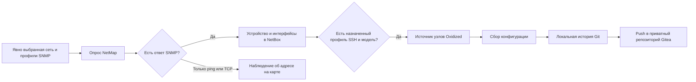

# NetMap: автоматическое наполнение NetBox и переход с Diode

Дата описания: 6 ноября 2026 года.

Документ описывает встроенные пути NetMap 1.1.0: SNMP, структурированный опрос
сетевого оборудования по SSH, Linux SSH и Windows WinRM/CIM. Все они используют
штатный REST API NetBox. Отдельные Diode и Orb в переносимой поставке не нужны.
Переключение существующего production-контура требует отдельного сопоставления
объектов и владельцев данных; эта реализация не меняет его автоматически.

Разделы 1–7 сохраняют описание и результаты ранее проверенной SNMP-ветки NetMap
1.0.0. Новые SSH/WinRM profiles, фоновые задания, запись IPAM и серверов описаны
в разделе 9. Проверки исходников, transport и установленной сборки различаются.

## Границы сравнения с исходным контуром

В сохранённых исходниках и документации исходного контура реализованы
несколько путей сбора:

- **Сетевой inventory через SSH:** Orb device discovery с NAPALM и адаптером
  Huawei VRP получает структурированные сведения об устройстве, интерфейсах
  и IP-адресах. Результаты поступают в NetBox через Diode. В документированном
  результате подтверждались также серийные номера. Это самостоятельный путь
  inventory, который не заменяется чтением конфигурации Oxidized.
- **История конфигураций через SSH:** Oxidized собирает конфигурации заданных
  устройств и сохраняет их в Git/Gitea.
- **Серверная инвентаризация:** отдельные Linux SSH и Windows WinRM/CIM
  collectors получают снимки для импорта в NetBox. В сохранённой документации
  эти импорты выполняются отдельно от Orb/Diode; автоматическое расписание
  для них там не заявлено.
- **Топология:** отдельный сборщик карты обрабатывает наблюдения связей;
  его функции и правила создания Cable требуют собственной сверки.

Read-only проверка действующего контура подтвердила отдельные роли Orb/NAPALM,
Diode и Oxidized. Установленный device-discovery runner вызывает facts,
interfaces, IP, VLAN, принадлежность портов VLAN и chassis; VRF включены явно.
Получение modules и running/startup в этом runner выключено. Наличие метода в
driver не считается доказательством включённого или успешного сбора.

В PL путь структурированного SSH inventory реализован собственными конечными
collectors на Paramiko. Код Orb/NAPALM и их plugin loader не переносится.
Oxidized продолжает независимо собирать конфигурации. Сетевой inventory,
история конфигураций и инвентаризация ОС имеют отдельные результаты и время
последнего успешного наблюдения.

## 1. Как проходит опрос

Первичное обнаружение выполняет NetMap через SNMP. Oxidized получает список
уже зарегистрированных устройств из NetBox и собирает их конфигурации.
Появление устройства в NetBox не зависит от успешного SSH-входа: это два
разных этапа с разными учётными данными и результатами.

Diode в этом пути не участвует. Adapter NetMap обращается к штатному NetBox REST
API. В модуле остаются семь компонентов: PostgreSQL, Valkey, NetBox,
NetBox worker, adapter, Oxidized и Gitea. Новый постоянный сервис для записи
обнаруженных объектов не нужен.

Установка модуля сама не запускает сканирование. Администратор добавляет сеть,
выбирает профили доступа и явно запускает опрос. Текущий опрос ограничен десятью
минутами; адреса обрабатываются восемью потоками. Следующий опрос нельзя запустить
параллельно уже выполняющемуся опросу этого adapter.

## 2. Какие сведения собираются

Текущий встроенный SNMP probe использует SNMP v2c. Он читает:

| Данные | Источник |
|---|---|
| Имя устройства | `sysName`, OID `1.3.6.1.2.1.1.5.0` |
| Описание устройства | `sysDescr`, OID `1.3.6.1.2.1.1.1.0` |
| Имя и описание интерфейса | `ifName`, `ifDescr` |
| Подпись интерфейса | `ifAlias` |
| Тип интерфейса | `ifType` |
| Административное и рабочее состояние | `ifAdminStatus`, `ifOperStatus` |

Опрос таблиц ограничен количеством строк и объёмом ответа. Счётчик ошибок
увеличивается при таймауте, ненулевом коде завершения клиента, превышении
допустимого объёма ответа или истечении общего deadline. Ограничение числа
строк само по себе не доказывает полноту таблицы: лишние строки обрезаются.
Сообщения SNMP об окончании таблицы не принимаются за дополнительные интерфейсы.

Community передаётся клиенту net-snmp через временный конфигурационный файл с
правами `0600`. Она не включается в аргументы `snmpget`/`snmpwalk` или отчёт
опроса. Временный файл удаляется после обращения к устройству.

Текущая реализация не собирает SNMP v3, таблицы IP-адресов с масками или
LLDP/CDP через этот probe. Наличие этих данных в другом процессе production
нельзя считать покрытым только потому, что Device появился в PL.

## 3. Разные пароли у устройств одной сети

Профили SNMP и SSH выбираются независимо.

Для сети можно задать до четырёх профилей SNMP в явном порядке. Для каждого
адреса NetMap пробует выбранные профили до первого успешного ответа. В отчёте
сохраняется, какие профили были проверены и какой сработал. Успех SNMP не
означает, что SSH-пароль из того же профиля подходит устройству.

У сети есть профиль SSH по умолчанию для первоначального подключения новых
устройств. Для отдельного устройства можно назначить другой профиль и модель
Oxidized. Уже существующие назначения не меняются при повторном SNMP-опросе
или при смене сетевого профиля по умолчанию.

Пример: два коммутатора одной сети отвечают на разные community, а маршрутизатор
использует другой SSH-пароль. В сеть добавляют нужные SNMP-профили; SSH-доступ
задают отдельно для сети и при необходимости переопределяют у устройства.

Прежняя конфигурация с одним объединённым профилем поддерживается: пока явный
список SNMP-профилей не сохранён, community берётся из прежнего профиля сети.
Явный пустой список означает отсутствие SNMP-опроса, а не выбор всех профилей.

## 4. Как объекты создаются и обновляются

### Устройство

Идентификатор сети вычисляется из её канонического CIDR. Для поиска ранее
созданного устройства используются два custom field:

- `pl_source = network:<идентификатор сети>`;
- `collector_ip = адрес, по которому выполнен опрос`.

Это идентичность в пределах источника. Имя, похожий MAC или одинаковый IP в
другой сети не являются основанием автоматически объединить объекты. При
нескольких совпадениях запись останавливается с ошибкой.

Для нового устройства adapter создаёт или находит площадку сети, базового
производителя и тип `Discovered`, роль `Network device`, затем создаёт Device.
Имя берётся из `sysName`; при отсутствии имени используется адрес. Конфликт
имени в той же площадке разрешается стабильным суффиксом.

Новый Device получает tag `pl-managed` и observation fields. Когда сетевой
профиль содержит SSH-пользователя, пароль и модель Oxidized, добавляются
`network-config-backup` и `collector_profile`.

При повторном опросе существующего Device обновляются только наблюдаемые
имя и описание — `pl_observed_name` и `pl_observed_description`. Adapter
повторно читает объект с ETag и выполняет условный PATCH с `If-Match`.
Изменение объекта между чтением и записью не должно быть затёрто.

Ручные имя, площадка, роль, комментарии, tags, собственные custom fields,
назначенный SSH-профиль и переопределение модели сохраняются.

### Интерфейс

Интерфейс сопоставляется в пределах Device по `pl_source` и `pl_if_index`.
Первый опрос создаёт Interface с наблюдаемыми именем, типом, подписью и
административным состоянием. Для следующих опросов используются observation
fields:

`pl_observed_if_name`, `pl_observed_if_alias`, `pl_observed_if_type`,
`pl_observed_admin_status`, `pl_observed_oper_status`.

Ручные `name`, `type`, `description`, `enabled` существующего Interface
сохраняются. Если новый обнаруженный интерфейс конфликтует по имени с уже
существующим ручным объектом, он не захватывается автоматически: увеличивается
`manual_conflicts`.

Этот путь не удаляет устройства или интерфейсы, переставшие отвечать. Нельзя
считать один неуспешный опрос доказательством, что объект нужно удалить.

### Что не становится объектом NetBox

Ответ только на ICMP или TCP сохраняется как адресное наблюдение для карты.
Импортированные DHCP/ARP/Wi-Fi reports также остаются наблюдениями. Они не
создают Device, Interface или IPAddress автоматически.

Адрес управления сейчас хранится в `collector_ip`. Это не создание объекта
IPAddress в IPAM и не назначение `primary_ip` устройству. Physical Cable также
не создаётся: ARP/FDB или соседство адресов не доказывают соединение физических
портов. Карта читает зарегистрированные Cable из NetBox.

## 5. Как устройство попадает в Oxidized

Adapter публикует аутентифицированный внутренний источник
`/internal/oxidized/nodes`. Он выбирает Device с tag `network-config-backup`,
адресом `collector_ip` и действующим `collector_profile`.

Модель берётся из `oxidized_model` у Device; если переопределение пустое — из
профиля. Нужны также имя пользователя и пароль SSH. Имя узла Oxidized имеет
вид `device-<NetBox ID>`, поэтому ручное переименование Device не создаёт новый
узел коллектора.

SSH host keys берутся из `ssh_known_hosts` выбранных профилей. Проверка ключей
сохраняется. Добавление устройства не означает автоматического доверия любому
ключу, предъявленному по его адресу.

После записи inventory adapter обновляет источник коллектора. Oxidized
сохраняет конфигурацию в локальный Git, а hook `post_store` отправляет историю
в приватный репозиторий Gitea `pl-collector/device-configs`.

Сбор running/startup определяется моделью Oxidized. Замена процесса inventory
сама не переносит специальные модели действующего контура и не подтверждает
эквивалентность собранных конфигураций. Running нельзя сохранять в startup
сетевого устройства ради получения снимка.

## 6. Как проверить результат в интерфейсе

1. Добавить профиль с действующей SNMP community. Если нужны конфигурации,
   подготовить SSH-доступ, модель Oxidized и доверенный host key.
2. Добавить небольшую известную сеть или отдельный `/32`, выбрать SNMP-профили
   и при необходимости SSH-профиль по умолчанию.
3. Запустить опрос и дождаться его конечного результата.
4. Проверить появление Device и Interface в NetBox, а не только адреса на карте.
5. При настроенном SSH проверить узел `device-<ID>` в Oxidized и конфигурацию
   с историей в Gitea.
6. Повторить опрос. ID Device/Interface должны остаться прежними; дубликаты
   появляться не должны.
7. Изменить подпись тестового интерфейса вручную и повторить опрос: ручная
   подпись должна сохраниться, наблюдаемая подпись обновляется отдельно.

Основные поля результата: `targets_total`, `responders`, `unresponsive`,
`devices`, `device_ids`, `interfaces_created`, `interfaces_updated`,
`manual_conflicts`, `errors`, `observed_hosts`, `warnings`, `snmp_attempts` и
состояние `collector`. Счётчик `devices` — число обработанных устройств,
а не число новых Device: при втором опросе он также может быть ненулевым.

При ошибке записи в NetBox опрос получает конечное состояние `error`.
Успешный ответ SNMP и появление точки на карте сами по себе не подтверждают
успешную запись inventory или сбор конфигурации.

## 7. Проверки реализации

Ключевой integration test —
[`test_netmap_enrollment.py`](../../installer/tests/test_netmap_enrollment.py).
Он выполняет настоящий `poll → enroll → sync_interfaces → nodes` и использует
настоящий SQLite Store. Подменены SNMP probe и граница HTTP NetBox; это source
integration test, не доказательство работы настоящих SNMP/NetBox/Oxidized.

В сценарии два устройства отвечают через разные SNMP-профили. Первый опрос
создаёт два Device и четыре Interface. Повторный опрос выполняет только PATCH,
сохраняет ID, ручные поля, tags и независимое назначение SSH. Смена сетевого
SSH default не перезаписывает существующее назначение устройства.

На 6 ноября targeted suite `test_netmap*.py` прошёл: 171 тест. Независимая
проверка документа и теста также выполнена.

### Живая проверка 6 ноября 2026 года

Проверялась существующая установка **PL 0.5.6 / NetMap 1.0.0** с одним
контролируемым имитатором сетевого устройства. SNMP и SSH действительно
передавались по сети; запись шла в настоящий NetBox, сбор — через настоящий
Oxidized, история — в Git/Gitea. Это не опрос физического маршрутизатора.

Точная identity проверенного adapter: source SHA256
`a63db47bd65388c472663fd70d4648afb71c6ce13510d5e05fd1e06bab06ff44`,
artifact SHA256
`e6a141e28e29191e336710a7bb961cd4b1fea090b847f6cc0d992d927c2c2787`.

| Проверка | Наблюдаемый результат |
|---|---|
| Первый обычный опрос через сессию PL и CSRF | Один ответивший `/32`, один Device, два Interface, ноль ошибок |
| Повторный опрос | Прежние ID; ноль новых Interface, два обновления, ноль ошибок |
| Ручные правки тестовых объектов | Device comments, Interface description/enabled сохранены |
| Источник Oxidized | Один target, состояние `ready` |
| SSH и чтение конфигурации | Две успешные аутентификации, два чтения, ноль отказов аутентификации |
| История | Локальный Git и Gitea подтвердили один commit `fb2bbb77cd0f04c47c3bb5f3b3f31a78991c33ac` |

На этой установке запрос нового маршрута просмотра устройств вернул HTTP 403.
Поэтому результат записи читался через native NetBox API из существующего
adapter. Эта проверка не подтверждает новый UI/API core 0.5.7
или несколько упорядоченных SNMP-профилей в новом artifact: для последних
подтверждён source integration test выше.

После проверки временный процесс-имитатор, профиль, сеть, Device, Interface
и площадка теста удалены; inventory вернулся к исходному составу. История
тестового сбора оставлена в Git/Gitea, репозиторий не переписывался.

Все 26 container ID, image и mounts сохранились. Core и соседние сервисы не
перезапускались. После удаления последнего target Oxidized завершился с кодом 1
и был автоматически запущен его restart policy; wrapper вернулся в
`waiting_targets`, targets = 0. Это зафиксированное ограничение поведения
проверенной версии при очистке пустого источника, а не ручной restart.

## 8. Что нужно проверить перед упрощением production

Сам факт наличия Diode не означает, что его можно удалить после успешного
опроса одного устройства. Сначала нужно перечислить всех writers и потребителей
inventory действующего контура.

| Функция | Текущий путь PL | Что проверить в действующем контуре |
|---|---|---|
| Сетевой inventory по SSH | Встроенные Huawei VRP, Cisco IOS/IOS-XE и Junos collectors → API NetBox | Применимость команд к моделям и firmware, fields и сохранение существующих ID |
| SNMP Device и Interface | Есть | Набор OID, поддержка v2c/v3, качество определения модели |
| Разные профили одной сети | До четырёх SNMP; отдельный SSH/WinRM profile у каждого inventory target | Доступ со стороны хоста PL, доверенные host keys и сертификаты |
| SSH-конфигурации и история | Oxidized → Git/Gitea | Специальные модели, running/startup, права и прежняя история |
| IPAddress, Prefix, primary IP | Создаются и обновляются из фактического SSH/WinRM snapshot | Конфликты адресов, VRF, ownership и первичные IP |
| Linux и Windows | SSH/Python и WinRM/CIM → Device/VirtualMachine, CPU/RAM, NIC, диски | Права чтения и связь с прежними объектами |
| VMware/vCenter и иные внешние источники | Отдельный discovery API не добавлен; VM определяется по сведениям гостевой ОС | Источник VM, привязка к cluster/hypervisor и прочие writers действующего контура |
| LLDP/CDP и динамические связи | Этот probe не собирает | Свежесть наблюдений, conflicts и владелец записи Cable |
| Ручные объекты | Не захватываются по похожему имени/IP | Сопоставление с существующими ID и правила ownership |

Практический порядок модернизации:

1. Зафиксировать фактические источники Diode/Orb, схемы идентичности, profiles,
   поля, jobs и потребителей. Отдельно отметить записи IPAM, виртуализации,
   серверного inventory и связей: они не покрываются этим SNMP probe.
2. Выбрать одну согласованную сеть и составить явное сопоставление её
   существующих NetBox ID с новым источником. Переход на `pl_source` нельзя
   выполнять созданием второго комплекта Device поверх прежнего inventory.
3. Определить, какие поля принадлежат опросу, а какие человеку или другому
   источнику. У одного поля должен быть понятный writer; две независимые
   системы не должны одновременно исправлять результаты друг друга.
4. На выбранной сети проверить первый и повторный опросы, стабильность ID,
   ручные правки, доступ Oxidized и прежнюю историю Git/Gitea. Не менять
   существующие физические Cable ради совпадения с обнаружением.
5. Переключить только writer выбранного источника. Сохранить возможность
   вернуть его прежнюю policy; текущие ручные изменения NetBox при этом не
   откатываются целиком.
6. Отключать сервисы Diode/Orb только после подтверждения, что для каждого
   оставшегося источника и потребителя есть проверенная замена.

Полная замена Diode действующего контура текущей PL не подтверждена.
В NetMap 1.1 добавлены собственные SSH/WinRM collectors и прямая запись
нормализованных результатов в NetBox; их контракт описан в разделе 10.
Это отдельные явно настроенные источники. Переключение существующих
Orb/NAPALM policies требует сопоставления их объектов и владельцев полей.
Источник виртуальных машин действующего контура пока не установлен;
замена его сбора новым модулем не подтверждена.

Цель такого перехода — сохранить способы сбора и их данные, упростив путь
записи. Потребление памяти всей PL на машине 2 vCPU / 4 GB этой проверкой
ещё не измерено.

## 9. Где находится код

| Файл | Назначение |
|---|---|
| [`service.py`](../../apps/netmap-stack/service.py) | `probe`, `probe_profiles`, `poll`, `enroll`, `sync_interfaces`, `nodes` |
| [`netbox-bootstrap.py`](../../apps/netmap-stack/netbox-bootstrap.py) | Служебная авторизация, tags и custom fields NetBox |
| [`oxidized-start.rb`](../../apps/netmap-stack/oxidized-start.rb) | Источник узлов, SSH, Git и hook Gitea |
| [`known-hosts-source.rb`](../../apps/netmap-stack/known-hosts-source.rb) | Доверенные SSH host keys |
| [`netmap-controller.py`](../../installer/netmap-controller.py) | Состав и lifecycle принадлежащих установке компонентов |
| [`netmap.Dockerfile`](../../monitoring/source/it-portal/deploy/images/netmap.Dockerfile) | Закреплённые образы и entrypoints |
| [`netmap.sources.json`](../../monitoring/source/it-portal/deploy/images/netmap.sources.json) | Версии и состав поставки |

Служебные credentials, runtime state и конфигурации устройств в этот документ
и публичные исходники не включаются.

## 10. Встроенный inventory по SSH и WinRM

Для обновления установленного NetMap 1.0 сначала требуется PL 0.6.1.
Этот переход сохраняет прежние образы PostgreSQL и Valkey, версии NetBox,
Oxidized и Gitea, данные и настройки модуля. После обновления PL откройте
настройки обновлений и обновите NetMap до 1.1. Новая установка получает
NetMap 1.1 сразу из каталога модулей.

В настройках NetMap откройте «Инвентаризация устройств и серверов». Добавьте
профиль доступа, затем устройство с его IP-адресом и выбранным профилем.
Два устройства одной сети могут использовать разные профили. После сохранения
редактор закрывается, а действующие настройки остаются в карточке.

Кнопка проверки профиля читает данные устройства, не записывая их в NetBox.
«Собрать данные» создаёт фоновое задание. Для автоматического обновления выберите
интервал у конкретного устройства: ручной запуск, 15 минут, час или сутки.
API поддерживает интервалы от 5 минут до суток. Добавление модуля или сети само
по себе не запускает discovery или обход адресов.

| Путь | Что получает | Куда записывает |
|---|---|---|
| Huawei VRP, Cisco IOS/IOS-XE, Junos по SSH | Имя, модель, serial, ОС, интерфейсы, MAC и IP/CIDR; доступные дополнительные сведения зависят от driver | Device, Interface, MACAddress, IPAddress и Prefix |
| Huawei: дополнительные getters | VLAN и принадлежность портов, VRF, наблюдения chassis при наличии поддержанного ответа | VLAN/VRF и назначения интерфейсов; chassis в observation, без выдуманной VirtualChassis |
| Linux по SSH | Сведения ОС, CPU/RAM, диски, сетевые интерфейсы, MAC и адреса | Device либо VirtualMachine; VMInterface/Interface, IPAM и VirtualDisk для VM |
| Windows по WinRM/CIM | ComputerSystem, OperatingSystem, BIOS, DiskDrive и сетевые адаптеры | Device либо VirtualMachine; интерфейсы, MAC/IP, CPU/RAM и диски |

На целевом Linux нужен Python 3. `ip`, `lsblk` и `systemd-detect-virt` дополняют
снимок; при их отсутствии результат содержит понятное предупреждение. Получение
serial может потребовать дополнительных прав чтения. Подтверждённые loopback и
veth-интерфейсы пропускаются; bridges, bonds и VLAN сохраняются. Название
интерфейса само по себе не доказывает его аппаратный тип.

Для SSH нужен доверенный ключ сервера в формате known_hosts. Ключ должен быть
сверен с устройством или существующим доверенным источником. Допустимы пароль
или закрытый SSH-ключ; agent и перебор файлов ключей выключены. Сборщик выполняет
конечный набор команд чтения, не принимает произвольный CLI и не сохраняет
running configuration в startup.

Windows использует NTLM. HTTPS включён по умолчанию, сертификат проверяется
через системные CA либо указанный CA. При явно выбранном HTTP шифрование NTLM
сообщений обязательно. Перенаправления и переменные proxy окружения для доступа
к оборудованию не используются.

Пустые поля секретов при редактировании сохраняют действующие значения.
Переключение пароль/ключ выполняется явно. Для удаления passphrase, enable
password или собственного CA есть отдельные действия. GET profiles возвращает
только признаки наличия секретов, а не их значения.

### Ownership и повторный сбор

Источник получает постоянный UUID. Custom fields `pl_inventory_source` и
`pl_inventory_key` связывают с ним native объекты. JSON `pl_inventory` хранит
последнее наблюдение и ранее записанные native значения. Это позволяет
отличать новое наблюдение от ручного изменения поля в NetBox.

Проверка перед PATCH использует ETag/If-Match. Чужие tags, custom fields,
назначения MAC/IP, роли, site, ручные имена и описания не перезаписываются.
Поле обновляется, когда оно всё ещё соответствует значению, ранее принятому от
этого collector. Конфликт отображается в результате задания. Повтор после
потерянного ответа API находит уже созданный объект по ownership и сохраняет ID.

Чтобы дополнить ранее найденное по SNMP устройство, у network SSH target явно
выберите существующую сеть. Принимается только однозначное совпадение
`network:<id>` и collector IP. Похожее имя, совпавший MAC либо адрес чужого
источника не дают права захватить объект. Для прежнего production inventory
понадобится отдельное согласованное сопоставление ID: автоматического массового
переназначения владельца нет.

Группа VLAN относится к выбранной сети; устройства этой сети могут ссылаться
на общий VID. Без выбранной сети пространство VLAN принадлежит target.
Уникальный существующий VRF/Prefix можно использовать как ссылку, сохраняя его
поля и владельца. Неоднозначность требует разбора, а не создания дубля.

Физические CPU/RAM и диски сохраняются в observation, поскольку у native Device
нет соответствующих CPU/RAM-полей. Для VirtualMachine используются native vCPU,
memory и VirtualDisk. Байтный размер диска сохраняется в observation; в native
API передаётся единица, которую требует используемая версия NetBox.

### Задания и ошибки

Работают два collector worker, в активной очереди — не более 16 заданий.
Для одного target нельзя одновременно запустить два сбора. Удаление или
изменение используемого активным заданием профиля/target отклоняется.
Проверка доступа имеет бюджет 20 секунд и не удерживает общий mutation lock.
Бюджет фонового задания — 180 секунд; collector ограничен 90 секундами,
отдельный native API request — оставшимся бюджетом и 20 секундами.

Collector выполняется в конечном дочернем процессе. Истечение deadline
завершает процесс вместе с SSH/WinRM соединением. Writer прекращает остальные
API-вызовы после исчерпания бюджета. Уже принятые изменения остаются в NetBox;
частичный результат показывает их counts/ID и допускает явный повтор.

После перезапуска queued/running задания становятся failed с причиной
прерывания. Автоматического повторного запуска прерванной операции нет.
Потеря связи, неверные credentials, несовпадение host key, TLS и неподдержанный
обязательный ответ не превращаются в успешный пустой snapshot.

Удаление target/profile не удаляет native inventory и историю. Отсутствие
устройства или интерфейса в очередном снимке также не удаляет прежнюю запись.
Физические Cable не создаются и не перемещаются по результату этого опроса.
Для VM не угадывается hypervisor, cluster либо физический порт.

### История конфигураций

Новый inventory profile сам не включает Oxidized. Для конфигураций назначается
профиль в существующей настройке доступа устройства и поддержанная модель
Oxidized. Сбор inventory не меняет прежний collector profile, tag и Git/Gitea
history. При переходе с другого writer это проверяется отдельно.

### Проверки нового пути

Проверены реальные SSH password/key sessions, host-key refusal, конечные сроки,
ограничения вывода, TLS/NTLM handshake и запрет redirects. Регрессии writer
проверяют принятые, но потерянные ответы POST/PATCH, manual edits, назначения
MAC/IP, SNMP attachment и отсутствие дублей при повторе.

Отдельно выполнены read-only проверки на работающем Huawei USG и Windows Server
2022 через существующий зарегистрированный доступ, а также полный SSH-сбор на
тестовом Linux. Это подтверждает соответствующие transport/CLI/CIM пути.
Приёмка готового артефакта, штатного обновления модуля и интерфейса после входа
фиксируется по версии и хешу поставки.

## 10. Подключение устройства в NetMap 1.2

Откройте **NetMap → Устройства → Добавить устройство**. Введите IP-адрес и
данные входа. Для SSH Платформа сначала читает публичный ключ. Сверьте
отпечаток с доверенным ключом устройства, затем нажмите «Добавить и опросить».
Платформа сохраняет подключение и запускает первый опрос. В списке появятся
имя, модель и результат опроса. Действие «На карте» открывает карточку устройства.

В расширенных настройках можно выбрать порт, ключ для входа, расписание или
сохранённый профиль. Для устройств одной сети можно использовать разные
профили. Пакетные опросы SNMP находятся в разделе **Сети**, а общие профили
и история конфигураций — в разделе **Доступ и конфигурации**.

Сетевой сборщик выбирает CLI по ответу устройства в режиме «Определить
автоматически». Систему также можно выбрать вручную. Добавлены FriendlyWrt/OpenWrt,
MikroTik RouterOS, KeeneticOS и управляемые TP-Link JetStream с SSH CLI.
Модели с SNMP можно добавить через опрос сети. Linux и Windows сохраняют свои
режимы SSH и WinRM.

NetMap читает интерфейсы, адреса и доступные таблицы соседей подключённого
устройства. ARP, NDP, DHCP, FDB и LLDP/CDP отображаются как наблюдения с
источником и временем опроса. Физические кабели отображаются из NetBox.
Для прямого опроса соседнего устройства подключите его доступ отдельно.

Технически `POST /inventory/ssh-host-key` завершает SSH-сеанс после обмена
ключами. `POST /inventory/enroll` в одной транзакции сохраняет профиль,
устройство, задание и ответ для повторного запроса. Первый опрос выполняет
обычная очередь NetMap, с теми же правилами записи в NetBox и сохранения
ручных правок. При обновлении до 1.2 сохраняются установленные PostgreSQL и
Valkey.

Команды и форматы проверены по документации
[OpenWrt](https://openwrt.org/docs/techref/ubus),
[MikroTik](https://manual.mikrotik.com/docs/management-tools/ssh/),
[Keenetic](https://storage.googleapis.com/docs.help.keenetic.com/cli/4.1/en/cli_manual_kn-2410.pdf)
и [TP-Link](https://www.tp-link.com/us/configuration-guides/managing_system/).
